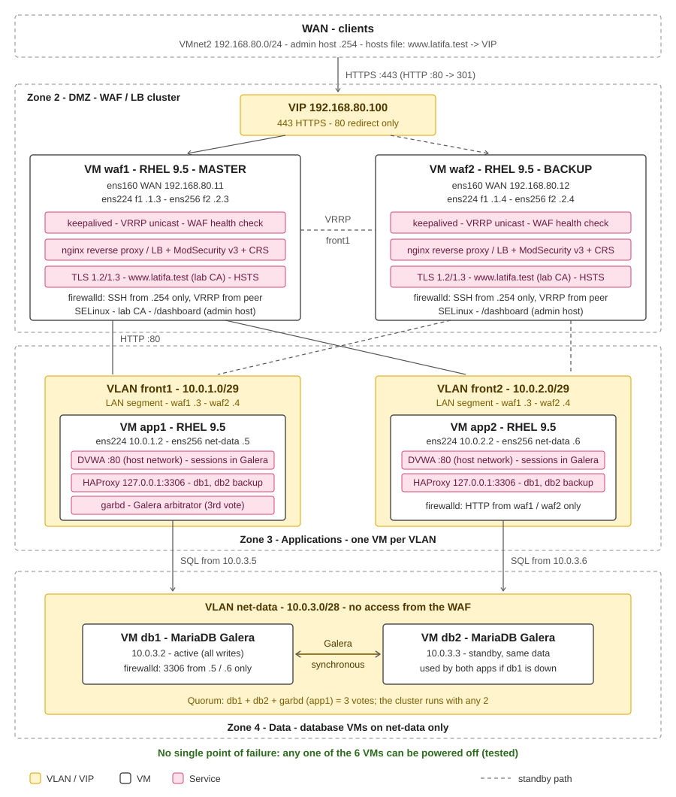
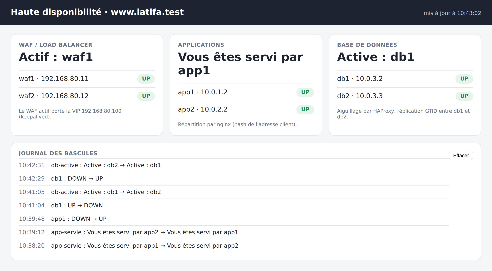

# High-Availability Web Application Behind an Open-Source WAF

Lab build of a secure, highly available hosting architecture for a web application and its database: nginx + ModSecurity + OWASP Core Rule Set at the edge behind a keepalived virtual IP, two application nodes, and a MariaDB Galera cluster, on RHEL 9.5 (VMware Workstation). DVWA is the protected test application.

Documentation (reproducible runbook): [docs/00-index.md](docs/00-index.md)

## Status

**V3 completed**, tag `v3.0`: no single VM failure stops the service.

| Layer | VMs | Failover |
|---|---|---|
| Edge: WAF, load balancer, TLS | waf1, waf2 + VIP | ~3 s (VRRP + WAF health check) |
| Applications | app1, app2 (separate VLANs) | ~10 s, user stays logged in (sessions in Galera) |
| Database | db1, db2 (Galera, synchronous) + garbd arbitrator on app1 | ~4 s through a local HAProxy on each app, no data loss |

Validated by powering off each VM in turn: [docs/15-failover-tests.md](docs/15-failover-tests.md). Limitations: [docs/18-known-limitations.md](docs/18-known-limitations.md).

## Versions

| Version | Where | Summary |
|---|---|---|
| V3 | `main`, tag `v3.0` | 6 VMs, Galera + arbitrator, shared sessions |
| V2 | tag `v2.0`, branch `single-point-of-failure-lan` | Application and database tier on a single LAN VM (single point of failure) |

## Roadmap

- **Next:** automatic cold start of the cluster, TLS on the data network, Galera-aware health check, encrypted off-host backups.
- **Later:** security monitoring (Wazuh), centralised logging, Ansible automation.
